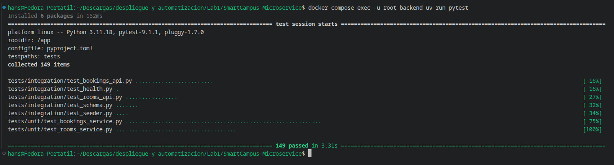
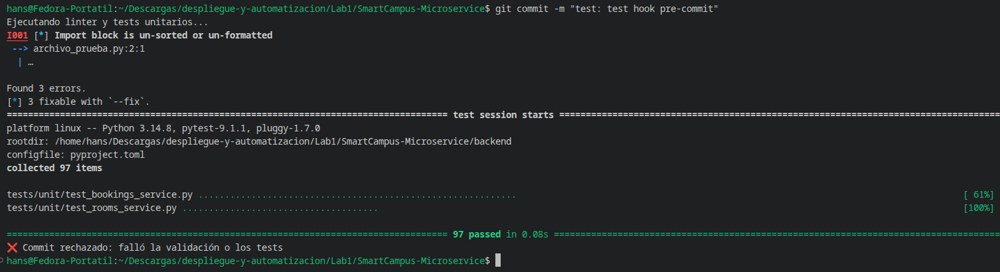
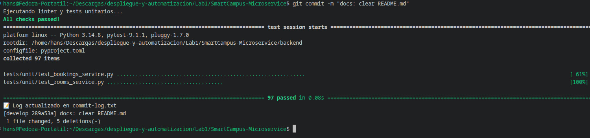
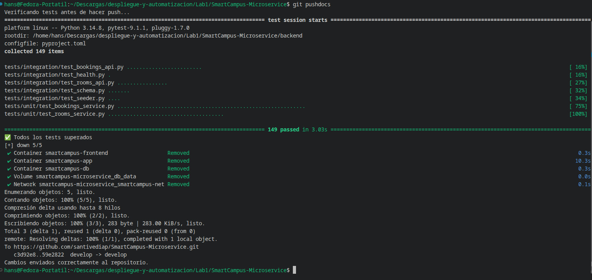
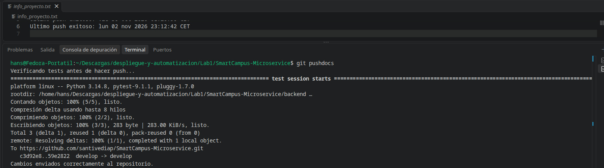
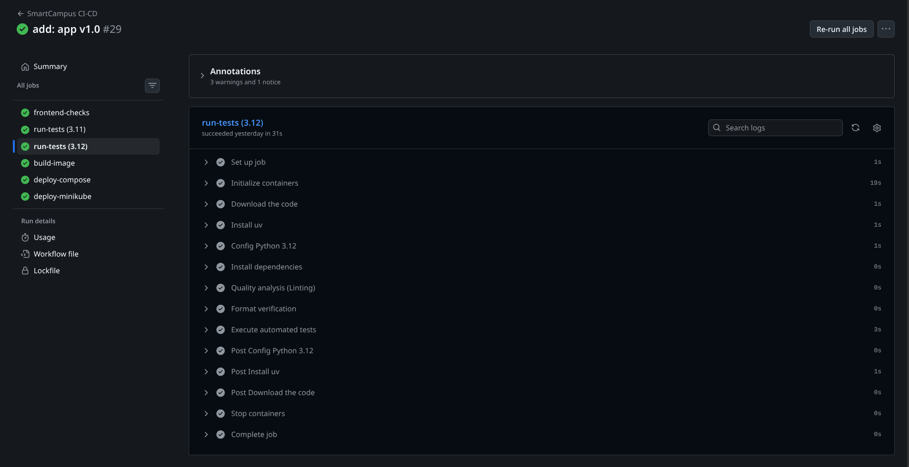
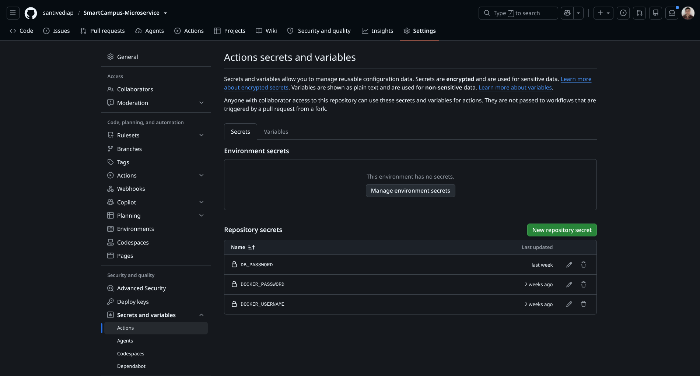
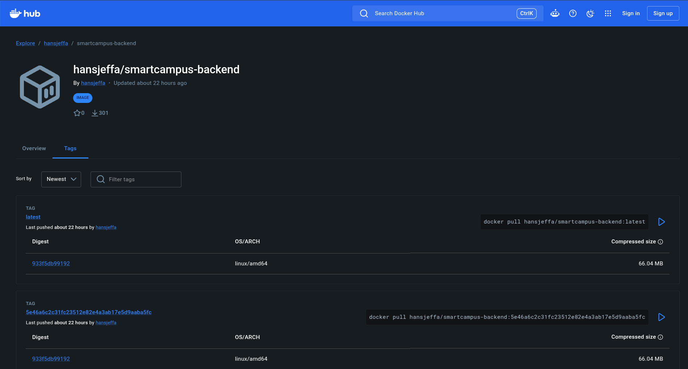
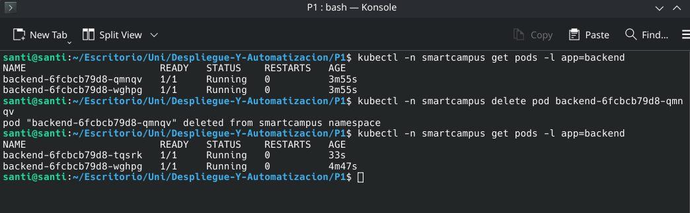
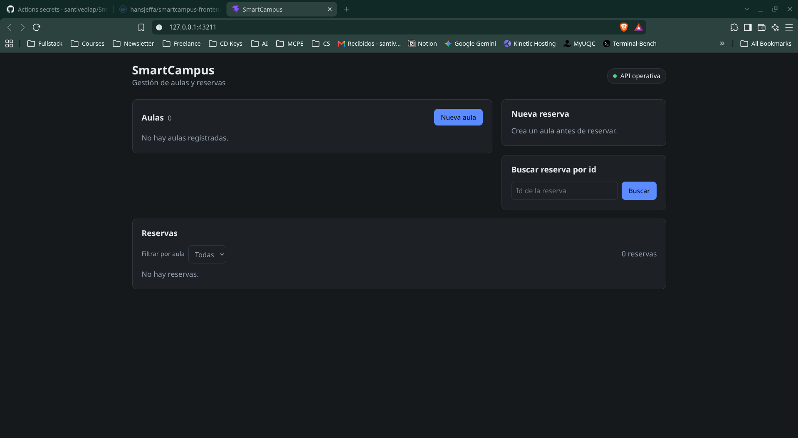

<<<<<<< HEAD
# SmartCampus Microservice

Repositorio: https://github.com/santivediap/SmartCampus-Microservice

## 📖 Descripción

Plataforma de **SmartCampus Solutions** para gestionar aulas y reservas de espacios universitarios.

**¿Qué problema resuelve?**
Centraliza la gestión de aulas y reservas, que suele hacerse de forma manual y descoordinada. La API valida automáticamente las reglas de negocio:

- No se puede reservar un aula inexistente.
- La hora de inicio debe ser anterior a la hora de fin.
- No puede haber dos reservas solapadas en la misma aula.
- No se pueden crear aulas con capacidad ≤ 0.
- No se puede eliminar un aula o una reserva inexistente.

El mismo repositorio se usa en dos asignaturas:

- **Despliegue y Automatización:** Git Hooks, Docker, Docker Compose y GitHub Actions (CI/CD).
- **Despliegue y Monitorización en la Nube:** despliegue multicontenedor con Docker Compose y Kubernetes (Minikube). La comparativa y las preguntas están en la memoria técnica.

> **Base de datos:** se usa PostgreSQL en lugar de SQLite porque el enunciado de Monitorización exige una base de datos independiente (PostgreSQL) y ambas prácticas comparten código.

## 🏗️ Arquitectura

```
                ┌──────────────────────────┐
  Navegador ──▶ │ FRONTEND (React + nginx) │  :8080 (Compose) / :30080 (K8s)
                └────────────┬─────────────┘
                             │ HTTP  /api/* → proxy inverso
                             ▼
                ┌──────────────────────────┐
                │ BACKEND (Flask REST API) │  :5000
                └────────────┬─────────────┘
                             │ SQL (psycopg 3)
                             ▼
                ┌──────────────────────────┐
                │ DATABASE (PostgreSQL 15) │  :5432 + volumen persistente
                └──────────────────────────┘
```

- **Frontend:** SPA en React (Vite). En producción nginx sirve el build estático y reenvía `/api/*` al backend quitando el prefijo (`/api/rooms` → `/rooms`). Así el navegador no necesita CORS.
- **Backend:** API REST en Python + Flask. Rutas (`app/routes`) → servicios con la lógica y validaciones (`app/services`) → PostgreSQL.
- **Base de datos:** PostgreSQL 15. El backend crea el esquema al arrancar (`app/schema.sql`), de forma idempotente y con un *advisory lock* para que varias réplicas no lo creen a la vez.
- **Comunicación:** por nombre de servicio, nunca por IP. En Compose: `backend`, `db`. En Kubernetes: `backend-service`, `database-service`.

### Endpoints

| Método | Ruta | Descripción |
|---|---|---|
| GET | `/health` | Estado del servicio (también comprueba la BD con `SELECT 1`) |
| GET | `/rooms` | Lista de aulas |
| GET | `/rooms/{id}` | Aula por ID |
| POST | `/rooms` | Crear aula |
| DELETE | `/rooms/{id}` | Eliminar aula |
| GET | `/bookings` | Lista de reservas |
| GET | `/bookings/{id}` | Reserva por ID |
| POST | `/bookings` | Crear reserva |
| DELETE | `/bookings/{id}` | Eliminar reserva |

Ejemplo de aula:

```json
{
  "nombre": "Laboratorio de Robótica",
  "edificio": "Edificio A",
  "capacidad": 30,
  "equipamiento": ["ordenadores", "robots", "impresora 3D"]
}
```

## 📁 Estructura

```
.
├── .githooks/              # Hooks de Git versionados (pre-commit, post-commit, pre-push, post-push)
├── .github/workflows/
│   └── ci-cd.yml           # Pipeline de CI/CD
├── backend/
│   ├── app/
│   │   ├── routes/         # Endpoints HTTP (health, rooms, bookings)
│   │   ├── services/       # Lógica de negocio y validaciones
│   │   ├── config.py       # Configuración desde variables de entorno
│   │   ├── db.py           # Conexión a PostgreSQL y creación del esquema
│   │   ├── errors.py       # Errores de dominio → respuestas JSON
│   │   ├── schema.sql      # Tablas rooms y bookings
│   │   └── seeder.py       # Datos de ejemplo
│   ├── tests/
│   │   ├── unit/           # Tests unitarios de los servicios
│   │   └── integration/    # Tests de los endpoints HTTP contra PostgreSQL
│   ├── Dockerfile
│   ├── pyproject.toml      # Dependencias (gestionadas con uv)
│   └── wsgi.py             # Punto de entrada de Flask
├── frontend/
│   ├── nginx/              # Plantilla de nginx (estáticos + proxy /api)
│   ├── public/             # Recursos estáticos (favicon, iconos)
│   ├── src/                # Código React (componentes, cliente de la API)
│   └── Dockerfile          # Multi-stage: build con Node → servido con nginx
├── k8s/                    # Manifiestos de Kubernetes
├── docker-compose.yml      # Orquestación local: db, backend, frontend
├── .env.example            # Plantilla de variables de entorno
└── README.md
```

## 🧰 Tecnologías

| Capa | Tecnología |
|---|---|
| Backend | Python 3.11/3.12, Flask, psycopg 3 |
| Frontend | React 19, Vite, nginx |
| Base de datos | PostgreSQL 15 |
| Dependencias | `uv` (backend), `npm` (frontend) |
| Calidad | Ruff (backend), ESLint (frontend) |
| Tests | pytest (unitarios e integración) |
| Contenedores | Docker, Docker Compose |
| Orquestación | Kubernetes (Minikube) |
| CI/CD | GitHub Actions + *self-hosted runner* |

## 📋 Requisitos previos

- [Docker](https://docs.docker.com/get-docker/) con Docker Compose v2
- [Git](https://git-scm.com/) (Git Bash en Windows)
- [uv](https://docs.astral.sh/uv/getting-started/installation/) y Python 3.11 o superior (hooks y tests en local)
- Node.js 22 (solo para desarrollar el frontend sin Docker)
- [Minikube](https://minikube.sigs.k8s.io/docs/start/) y `kubectl` (solo para el despliegue en Kubernetes)

## ⚙️ Variables de entorno

Ningún valor que cambie entre entornos está en el código. Los `.env` reales están en `.gitignore`. Hay dos:

| Fichero | Lo lee | Contenido |
|---|---|---|
| `.env` (raíz) | Docker Compose y el hook `pre-push` | `DB_PASSWORD` |
| `backend/.env` | Flask (python-dotenv) al ejecutar el backend o los tests **fuera de Docker** | `DB_HOST`, `DB_PORT`, `DB_NAME`, `DB_USER`, `DB_PASSWORD` |

> `DB_PASSWORD` es obligatoria. El `docker-compose.yml` usa `${DB_PASSWORD:?DB_PASSWORD not set}` y Compose la valida para todo el fichero: si falta, **no arranca ningún servicio, ni siquiera `db`**.

| Variable | Uso | Valor por defecto |
|---|---|---|
| `APP_ENV` | Entorno de la app | `development` |
| `DB_HOST` | Host de PostgreSQL | `localhost` |
| `DB_PORT` | Puerto de PostgreSQL | `5432` |
| `DB_NAME` | Nombre de la BD | `smartcampus` |
| `DB_USER` | Usuario de la BD | `smartcampus` |
| `DB_PASSWORD` | Contraseña de la BD | — (obligatoria) |
| `BACKEND_URL` | URL del backend para el proxy de nginx | `http://backend:5000` |

## 🛠 Instalación y ejecución local

### 1. Clonar y configurar la contraseña

> ⚠️ **Paso obligatorio:** antes de cualquier `docker compose up`, crea el fichero `.env` en la **raíz del repositorio** (junto a `docker-compose.yml`) copiando `.env.example`. Sin él, Docker Compose no arranca ningún servicio.

```bash
git clone https://github.com/santivediap/SmartCampus-Microservice.git
cd SmartCampus-Microservice
cp .env.example .env    # Crea el .env en la raíz a partir de la plantilla
```

Edita `.env` (raíz) y pon una contraseña real:

```
DB_PASSWORD=smartcampus123
```

Comprueba que Compose la lee (si falta, muestra `DB_PASSWORD not set`):

```bash
docker compose config --quiet && echo "OK"
```

> PostgreSQL solo aplica `POSTGRES_PASSWORD` la **primera vez** que crea el volumen `db_data`. Si cambias la contraseña después, borra el volumen para que se vuelva a crear (se pierden los datos):
> ```bash
> docker compose down -v
> ```

### 2. Docker Compose (aplicación completa)

Requiere el `.env` de la raíz creado en el paso 1 (`cp .env.example .env`). Desde la raíz del repositorio:

```bash
docker compose up -d --build
docker compose ps
```

| Servicio | Contenedor | URL |
|---|---|---|
| `frontend` | `smartcampus-frontend` | http://localhost:8080 |
| `backend` | `smartcampus-app` | http://localhost:5000/health |
| `db` | `smartcampus-db` | `127.0.0.1:5432` (solo localhost) |

El Compose define:

- **Red** `smartcampus-net` (bridge): los servicios se resuelven por nombre.
- **Volumen** `db_data`: los datos sobreviven a `docker compose down` (no usar `-v`).
- **Healthchecks** en los tres servicios y `depends_on: condition: service_healthy` (db → backend → frontend).
- **Reinicio** `restart: always`.
- **Variables**: `DB_PASSWORD` se lee del `.env` y falla al arrancar si no existe.

Para pararlo: `docker compose down` (conserva los datos).

### 3. Backend y frontend sin Docker (desarrollo)

Solo la base de datos va en Docker. Si el stack completo está levantado, para antes el backend y el frontend para liberar los puertos 5000 y 8080:

```bash
docker compose stop backend frontend   # Solo si estaban levantados
docker compose up -d db
```

Crea `backend/.env` con **el mismo usuario, base de datos y contraseña** que el Postgres del Compose:

```
DB_HOST=localhost
DB_PORT=5432
DB_NAME=smartcampus
DB_USER=smartcampus
DB_PASSWORD=smartcampus123
```

Backend → http://localhost:5000/health

```bash
cd backend
uv sync
uv run flask --app wsgi run
```

Frontend → http://localhost:5173 (en otra terminal, desde la raíz; Vite reenvía `/api` a `localhost:5000`)

```bash
cd frontend
npm ci
npm run dev
```

### 4. Docker (solo la imagen del backend)

Prueba aislada de la imagen, con su propia red y su propio Postgres, sin depender del Compose. Si el Compose está levantado, páralo antes (`docker compose down`) para liberar el puerto 5000.

```bash
docker network create smartcampus-test
docker run -d --name test-db --network smartcampus-test \
  -e POSTGRES_USER=smartcampus -e POSTGRES_DB=smartcampus \
  -e POSTGRES_PASSWORD=secret postgres:15

docker build -t smartcampus-backend ./backend
docker run -d --name smartcampus-api --network smartcampus-test -p 5000:5000 \
  -e DB_HOST=test-db -e DB_PASSWORD=secret smartcampus-backend

curl http://localhost:5000/health   # {"env":"development","status":"ok"}
```

Si el `curl` falla nada más arrancar, espera unos segundos: Postgres tarda en aceptar conexiones (`docker logs smartcampus-api`).

Limpieza:

```bash
docker rm -f smartcampus-api test-db
docker network rm smartcampus-test
```

## 🧪 Tests

- **Unitarios** (`tests/unit/`): creación de aulas, validación de capacidad, fechas y horas, solapamientos, eliminaciones.
- **Integración** (`tests/integration/`): todos los endpoints y casos de error (aula inexistente, reserva solapada, capacidad inválida, ID inexistente, hora incorrecta). Usan una BD aparte, `smartcampus_test`, para no tocar los datos de desarrollo.

Los de integración necesitan PostgreSQL levantado (`docker compose up -d db`) y el `backend/.env` del paso 3 de la instalación.

```bash
cd backend
uv run pytest tests/unit      # Solo unitarios (sin BD)
uv run pytest                 # Unitarios + integración
```

Dentro del contenedor:

```bash
docker compose exec -u root backend uv run pytest
```

## 🪝 Git Hooks

Los hooks están versionados en `.githooks/`. Configúralos una vez tras clonar:

```bash
git config core.hooksPath .githooks
chmod +x .githooks/*
git config --global alias.pushdocs '!git push && echo "Cambios enviados correctamente al repositorio." && echo "Último push exitoso: $(date)" >> info_proyecto.txt'
```

| Hook | Cuándo | Qué hace | Bloquea |
|---|---|---|---|
| `pre-commit` | Antes del commit | `ruff check` + tests unitarios | Sí: `❌ Commit rechazado` |
| `post-commit` | Tras el commit | Añade autor, hash, mensaje y fecha a `commit-log.txt` | No |
| `pre-push` | Antes del push | Carga `.env` y ejecuta tests unitarios + integración | Sí: `❌ Push rechazado: existen tests fallidos` |
| `post-push` | Tras un push correcto | Muestra `Cambios enviados correctamente al repositorio.` y registra fecha, rama, commit y remoto en `info_proyecto.txt` | No |

> Git no tiene un hook `post-push` nativo. Por eso se ejecuta con el alias `git pushdocs`, que lanza un mensaje solo si `git push` termina bien. Úsalo en lugar de `git push`.

`commit-log.txt` e `info_proyecto.txt` están en `.gitignore`: son registros locales.

## 🔄 GitHub Actions (CI/CD)

Workflow: `.github/workflows/ci-cd.yml`.

**Cuándo se ejecuta:** en `push` y `pull_request` sobre `main`, `develop` y `create-git-hooks`. La publicación de imágenes y el despliegue solo se hacen en `push` a `main`.

```
 push / pull_request
          │
   ┌──────┴──────────────────────┐
   ▼                             ▼
run-tests (matrix)          frontend-checks
 Python 3.11 │ Python 3.12   ESLint + build Vite
 ruff check, ruff format     │
 pytest + PostgreSQL         │
   └──────────┬──────────────┘
              ▼
         build-image
 docker build backend + frontend
 validación: /health y /api/health
 push a Docker Hub (solo main)
              ▼
        deploy-compose  (self-hosted)
              ▼
        deploy-minikube (self-hosted)
```

| Etapa | Job / paso |
|---|---|
| 1. Checkout | `actions/checkout@v4` |
| 2. Instalación | `uv sync --frozen` (backend), `npm ci` (frontend) |
| 3. Calidad | `ruff check`, `ruff format --check`, `eslint` |
| 4. Tests | `pytest` (unitarios + integración) con un servicio `postgres:15` |
| 5. Build | `docker/build-push-action` para backend y frontend, etiquetadas con el SHA del commit |
| 6. Validación | Arranca BD + backend y comprueba `/health`; arranca el frontend y comprueba `/` y `/api/health` |
| 7. Deploy | `docker compose up -d --wait` y `kubectl apply` en el *self-hosted runner* |

- **Matrix:** `python-version: ["3.11", "3.12"]` con `fail-fast: true`.
- **Variables (`env:`):** `IMAGE_REPOSITORY` y `FRONTEND_IMAGE_REPOSITORY` a nivel de workflow; `DB_HOST`, `DB_USER` e `IMAGE_TAG` a nivel de paso.
- **Secrets:** `DOCKER_USERNAME`, `DOCKER_PASSWORD` (login en Docker Hub) y `DB_PASSWORD` (Compose y Secret de Kubernetes). No están en el código ni se imprimen en los logs.
- **Build Docker:** las imágenes solo se suben a Docker Hub después de pasar la validación, con las etiquetas `<sha>` y `latest`.
- **Despliegue (opción A, runner local):** el job corre en un *self-hosted runner*, por lo que los contenedores siguen vivos al terminar. Primero `docker compose pull` + `up -d --wait`; después carga las imágenes en Minikube, crea el Secret desde `DB_PASSWORD` y aplica `k8s/`, esperando al `rollout status` de cada recurso.

## ☸️ Kubernetes (Minikube)

### Recursos (`k8s/`)

| Fichero | Recurso | Detalle |
|---|---|---|
| `namespace.yaml` | Namespace | `smartcampus` |
| `configmap.yaml` | ConfigMap | `APP_ENV`, `DB_HOST`, `DB_PORT`, `DB_NAME`, `BACKEND_URL` |
| `secret.yaml.example` | Secret (plantilla) | `DB_USER`, `DB_PASSWORD`. El real nunca se sube |
| `database-statefulset.yaml` | StatefulSet | PostgreSQL, 1 réplica, PVC de 1 Gi |
| `database-service.yaml` | Service ClusterIP + headless | `database-service` y `database-headless` |
| `backend-deployment.yaml` | Deployment | 2 réplicas, readiness `/health`, liveness TCP |
| `backend-service.yaml` | Service ClusterIP | `backend-service:5000` |
| `frontend-deployment.yaml` | Deployment | 1 réplica |
| `frontend-service.yaml` | Service NodePort | puerto `30080` |

La base de datos usa **StatefulSet** y no Deployment: necesita un nombre de Pod estable (`database-0`) y un volumen propio que sobreviva al borrado del Pod. La justificación completa está en la memoria.

### Despliegue manual

```bash
minikube status || minikube start

# 1. Construir las imágenes y cargarlas en Minikube
docker build -t hansjeffa/smartcampus-backend:latest ./backend
docker build -t hansjeffa/smartcampus-frontend:latest ./frontend
minikube image load hansjeffa/smartcampus-backend:latest
minikube image load hansjeffa/smartcampus-frontend:latest

# 2. Namespace
kubectl apply -f k8s/namespace.yaml

# 3. Secret (nunca se escribe en el repo)
kubectl -n smartcampus create secret generic smartcampus-secret \
  --from-literal=DB_USER=smartcampus \
  --from-literal=DB_PASSWORD='<password>' \
  --dry-run=client -o yaml | kubectl apply -f -

# 4. Resto de manifiestos (secret.yaml.example se ignora por su extensión)
kubectl apply -f k8s/
kubectl -n smartcampus rollout status deployment/backend

# 5. Comprobar
kubectl -n smartcampus get pods,services,deployments,statefulsets
```

### Acceso al frontend

```bash
minikube service frontend-service -n smartcampus
# o bien: http://$(minikube ip):30080
```

### Escalado

```bash
kubectl -n smartcampus scale deployment backend --replicas=4
kubectl -n smartcampus get pods -l app=backend
kubectl -n smartcampus scale deployment backend --replicas=2
```

### Self-healing

```bash
kubectl -n smartcampus get pods -l app=backend
kubectl -n smartcampus delete pod <nombre-del-pod>
kubectl -n smartcampus get pods -l app=backend -w   # El ReplicaSet crea uno nuevo
```

### Cambio de configuración (ConfigMap)

Las variables se leen al arrancar el Pod. Tras editar el ConfigMap hay que reiniciar los Pods:

```bash
kubectl -n smartcampus edit configmap smartcampus-config     # p. ej. APP_ENV=staging
kubectl -n smartcampus rollout restart deployment/backend
curl http://$(minikube ip):30080/api/health                  # "env" refleja el nuevo valor
```

## 📸 Evidencias

Capturas en `docs/evidencias/`.

| Evidencia | Captura |
|---|---|
| Tests ejecutándose correctamente |  |
| `pre-commit` bloqueando un commit |  |
| `post-commit` y `commit-log.txt` |  |
| `pre-push` |  |
| `post-push` (`git pushdocs`) |  |
| Pipeline completo en GitHub Actions |  |
| Matrix Python 3.11 / 3.12 |  |
| Secrets configurados |  |
| Imagen Docker del backend en Docker Hub |  |
| Imagen Docker del frontend en Docker Hub |  |
| `docker compose ps` |  |
| Aplicación desplegada (Compose) |  |
| `kubectl get pods,services,deployments` |  |
| Escalado a 4 réplicas |  |
| Self-healing |  |
| Aplicación desplegada (Kubernetes) |  |
=======
>>>>>>> refs/remotes/origin/develop
